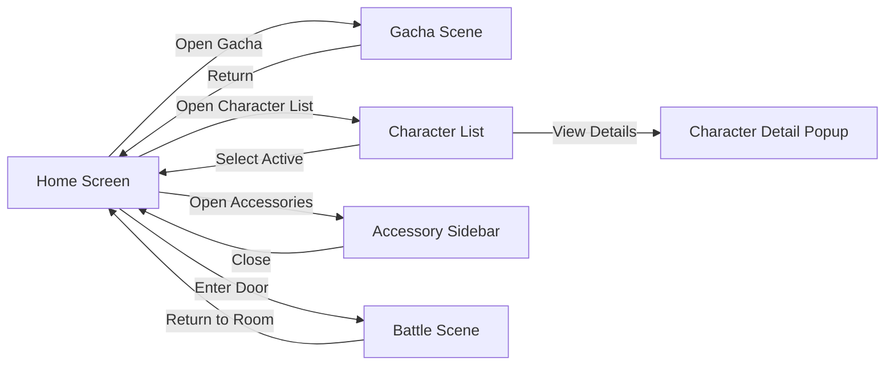
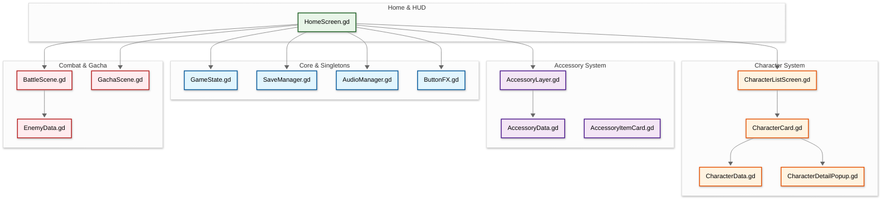
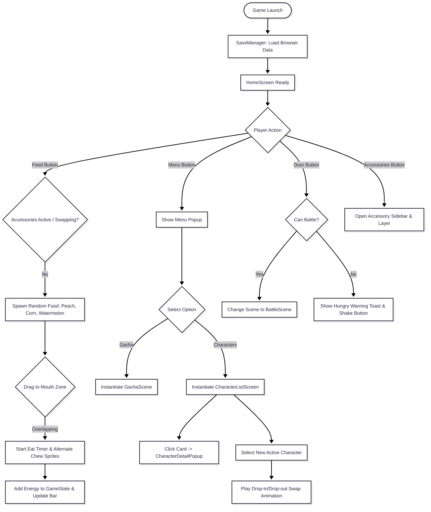
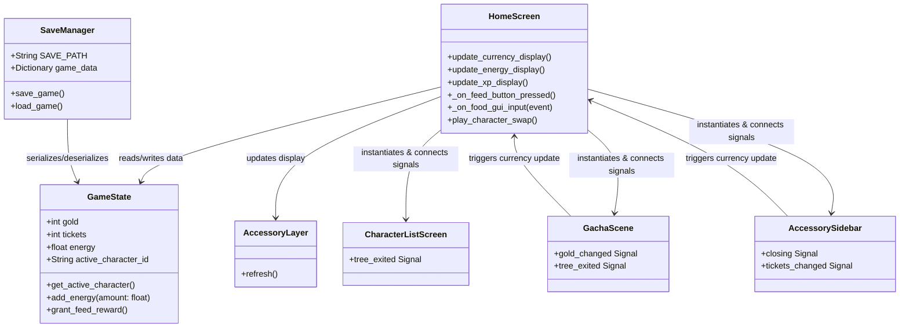

## Developer & Contributions
**nataalyly** (Game Programmer, Game Designer) 
**Akqua** (Game Artist, Game Designer)

## About
Crappybara is a cozy, relaxing companion and management game where players care for their very own capybara. Feed your capybara with delicious treats using intuitive drag-and-drop mechanics, manage its energy levels, unlock cute accessories through the sidebar system, collect rare capybaras via gacha, and customize your cozy space. Built with Godot 4 and optimized for smooth web deployment on Itch.io.

 

## Key Features
**Interactive Feeding System**: Feed your capybara by dragging food items (peaches, corn, and watermelon) directly into its mouth. Each bite restores energy and triggers dynamic chew animations and sound effects.

**Accessory & Character Customization**: Personalize your capybaras by equipping unique accessories through dedicated accessory layers, sidebars, and character management screens.

**Gacha & Roster Collection**: Expand your family of capybaras using the gacha system, inspect individual stats via detail popups, and seamlessly swap your active companion.

 

## Gameplay
<table>
  <tr>
    <td>
      
    </td>
    <td valign="top">

**Platform:** WebGL (Browser)  
**Engine:** Godot  
**Language:** GDScript  

 

  </td>
  </tr>
</table>

---

## Scene Flow

## Layer / Module Design

## Modules and Features
The game architecture is built modularly using Godot 4 GDScript, mapping directly to your project files:
| 📂 Script / Module | 📋 Core Responsibility |
|---------|-------------------|
| `HomeScreen.gd` | Controls main HUD layout, feeding mechanics (drag-and-drop food to mouth), energy updates, blinking intervals, character swap animations, and menu routing. |
| `GameState.gd` | Global manager tracking player currencies (gold, tickets), energy levels, experience points, and active character states. |
| `SaveManager.gd` | Handles persistent cross-session data storage via browser-safe JSON serialization (`FileAccess`) optimized for web/Itch.io deployment. |
| `AudioManager.gd` | Manages background music tracks and sound effects (like bite audio) with global volume and playback control. |
| `ButtonFX.gd` | Provides reusable juice and interactive feedback (such as button bounce effects) across UI elements. |
| `CharacterListScreen.gd` & `CharacterCard.gd` | Manages the roster grid interface, displaying owned capybaras, rarity markers, and selection states. |
| `CharacterDetailPopup.gd` & `CharacterData.gd` | Defines resource structures (`CharacterData`) and popup interfaces (`CharacterDetailPopup`) for inspecting specific character stats and details. |
| `AccessoryLayer.gd`, `AccessoryItemCard.gd`, `AccessoryData.gd` | Handles visual layering of equipped items onto capybaras, accessory sidebar item cards, and accessory resource definitions. |
| `GachaScene.gd` | Manages pulling mechanics, ticket/gold expenditure, and reward distributions to unlock new characters. |
| `BattleScene.gd` & `EnemyData.gd` | Manages combat encounters triggered from the room door, referencing enemy stat configurations (`EnemyData`) and handling stage progression. |

 

## Game Flow Chart

 

## Event Signal Diagram

 

## Controls
| Input | Action |
|---|---|
| `Left Click` & `Drag` | Drag food items from spawn point |
| `Left Click` (Buttons) | Navigate menus, gacha rolls, and toggle accessories |
| `Left Click` | Attack the enemy on BattleScene |

## Development Duration
~1 month — solo, from initial setup to WebGL deployment on itch.io

## Notes
- Best played on desktop via Google Chrome or Microsoft Edge.
- Found a bug? Feel free to open an issue.

## Credits
Made by [Natnat](https://github.com/nataalyly)
